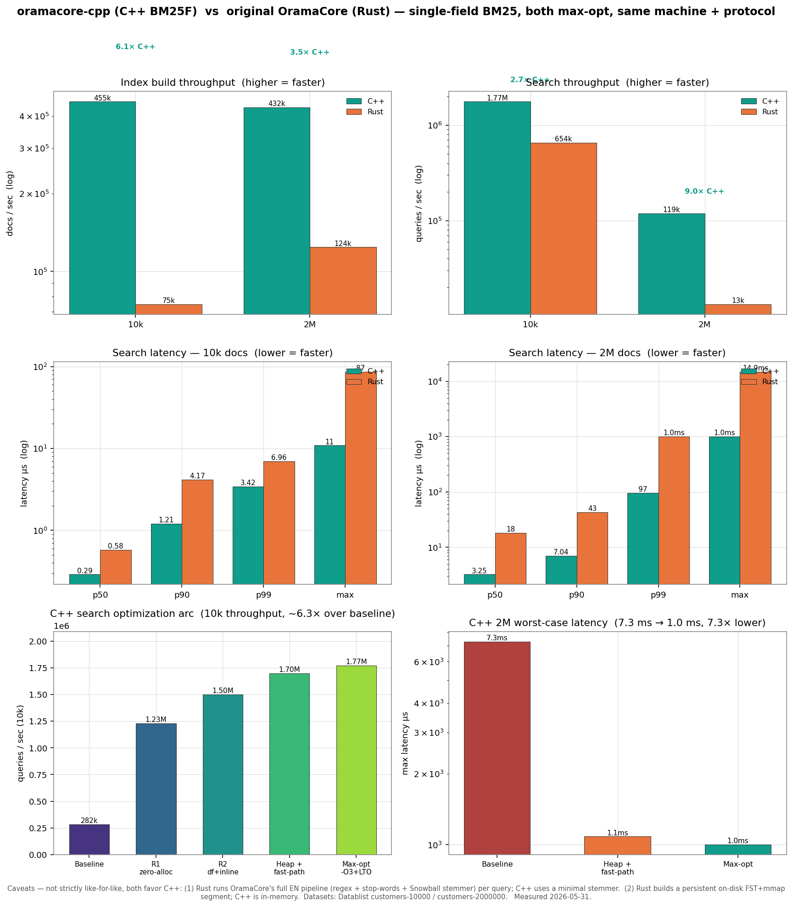
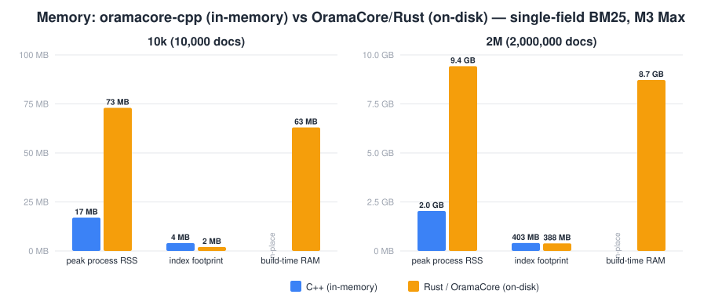

# Benchmarks

Two benchmarks over the same dataset + protocol, so we can compare this C++ engine
against the **original Rust OramaCore** BM25 index it was ported from.

- [`bench_csv.cpp`](bench_csv.cpp) — profiles **this** engine (`oramacore-cpp`): load a CSV → build the index → run thousands of searches → report index-build time, search throughput, and latency percentiles.
- [`rust-comparison/`](rust-comparison/) — a standalone Rust crate that drives the **real OramaCore** index (`oramacore_fields` 0.2.0 `StringStorage` + `oramacore_lib` 0.4.4 `TextParser`/Snowball), same dataset + protocol.

## Datasets

The [Datablist sample customer CSVs](https://www.datablist.com/learn/csv/download-sample-csv-files)
(`Index,Customer Id,First Name,Last Name,Company,City,Country,Phone 1,Phone 2,Email,Subscription Date,Website`):
`customers-10000.csv` (10k rows) and `customers-2000000.csv` (2M rows, 349 MB). Not committed —
point the benches at local copies.

## Protocol (both engines, identical)

- **Single-field BM25**: the text columns **First Name, Last Name, Company, City, Country**
  concatenated (space-joined) into one field per doc — matches a single Rust `StringStorage`.
  (`bench_csv` also has a default 12-field BM25F mode; `--single-field` is the comparable one.)
- **Index build** timed separately from CSV parsing.
- **Query pool**: distinct terms (len ≥ 3) from those columns; queries are 1 or 2 terms (50/50),
  RNG seed 42; 30,000 queries; `top_k = 100`; query tokenization is **inside** the timed loop
  (search = tokenize + lookup + score).

## Build + run

**C++ (max optimization — `-O3 -mcpu=native` + LTO):**
```sh
cmake -S . -B build-rel -G Ninja -DORAMACORE_CPP_BENCH=ON -DCMAKE_BUILD_TYPE=Release \
  -DCMAKE_CXX_FLAGS="-mcpu=native" -DCMAKE_INTERPROCEDURAL_OPTIMIZATION=ON
cmake --build build-rel
./build-rel/oramacore-cpp-bench /path/customers-2000000.csv --single-field --searches 30000 --topk 100
# flags: --single-field  --searches N  --topk K  --search-secs S (loop, for `sample`)  --index-loops K
```

**Rust (max optimization — `opt-level=3` + fat LTO + `codegen-units=1` + `target-cpu=native`, toolchain 1.91.1):**
```sh
cd rust-comparison
RUSTFLAGS="-C target-cpu=native" cargo build --release
BENCH_DATA_DIR=/path/to/csvs ./target/release/bench   # BENCH_BREAKDOWN=1 for the index-build phase split
```

## Results (2026-05-31, same machine, both max-opt)



> Full numbers — including the Rust **before vs after** maxing the compiler flags
> (thin-LTO vs fat-LTO+`target-cpu=native`) alongside the C++ max-opt build — are
> in **[`RESULTS.md`](RESULTS.md)**.

**Index build**
| | Rust (OramaCore) | C++ (oramacore-cpp) | C++ advantage |
|---|---|---|---|
| 10k | 134 ms (75k docs/s) | 22 ms (455k docs/s) | 6.1× |
| 2M  | 16.1 s (124k docs/s) | 4.63 s (432k docs/s) | 3.5× |

**Search** (30k queries, top-k=100)
| | Rust | C++ | C++ advantage |
|---|---|---|---|
| 10k q/s | 654k | 1.77M | 2.7× |
| 10k p50 / p99 (µs) | 0.58 / 6.96 | 0.29 / 3.4 | ~2× |
| 2M q/s | 13.2k | 119k | 9.0× |
| 2M p50 (µs) | 18.2 | 3.25 | 5.6× |
| 2M p99 (µs) | 1004 | 97 | 10.4× |
| 2M max (µs) | 14,887 | 1,003 | 14.8× |

**Memory** (peak RSS · index footprint · build spike — full detail + how-to-read in [`RESULTS.md`](RESULTS.md))
| | Rust (OramaCore, on-disk) | C++ (in-memory) |
|---|---|---|
| 2M peak process RSS | 9.4 GB | 2.0 GB |
| 2M index footprint | 388 MB (on disk) | ~403 MB (resident RAM) |
| 2M build-time RAM spike | ~8.7 GB transient | in-place |



The raw index is **~the same size both ways** (~390–400 MB at 2M) — the difference is *where it lives*: C++ keeps it resident in RAM (fast, jitter-free tail), OramaCore `compact`s it to a disk segment (low steady RAM, but the page-fault tail **and** an ~8.7 GB build-time spike — it holds the whole index in a `LiveLayer` before persisting). Probed with `getrusage(ru_maxrss)`; regenerate the chart via [`plot_memory.py`](plot_memory.py).

## Caveats — this is NOT strictly like-for-like (both asymmetries favor C++)

1. **Tokenizer asymmetry.** Rust runs OramaCore's full EN pipeline per query (regex Unicode
   tokenizer → lowercase → stop-words → **Snowball stemmer**); C++ uses a *minimal custom* stemmer.
   Rust does materially more linguistic work per query and per doc, and the term distributions
   (hence posting-list lengths) differ. A large part of the search-throughput gap is the tokenizer,
   not the BM25 inner loop.
2. **Persistence asymmetry.** Rust's `oramacore_fields` builds a **real on-disk FST + mmap-backed
   segment** (`compact()`) — persistent, with page-fault jitter (the 2M p99/max tail). C++ is a pure
   **in-memory** index. That accounts for much of the build gap and the 2M tail gap.

A strictly-fair comparison would (a) match tokenizers and (b) match persistence (persist the C++
index, or run Rust `LiveLayer`-only without `compact`). The fair one-liner: *a lean in-memory engine
with a minimal tokenizer is ~3–9× faster than the full persistent OramaCore with its complete NLP
pipeline* — not "the BM25 loop is 9× faster."

## What the profiling found (drove the search optimization)

Search is allocation-bound at small scale and **memory-latency-bound** on long posting lists, not
FLOP-bound — removing a divide/posting did not move the 2M tail. So the levers are: zero per-query
allocation (done), bounded top-k heap + single-term fast path (done), and — next — SoA/compressed
postings + WAND skip. GPU/MLX stays off the hot path: on long posting lists the cost is memory latency, which a GPU
does not remove.
