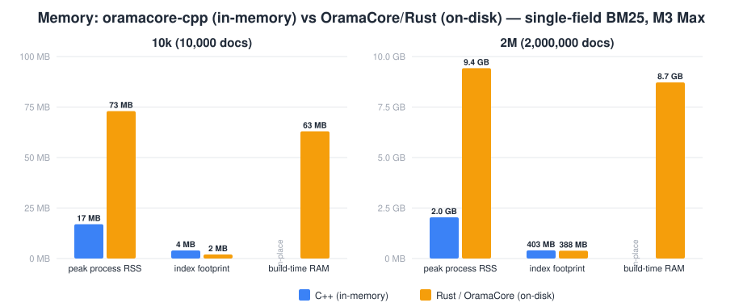

# Benchmark results — oramacore-cpp (C++) vs OramaCore (Rust)

Single-field BM25 over the [Datablist customer CSVs](https://www.datablist.com/learn/csv/download-sample-csv-files),
identical protocol (see [`README.md`](README.md)). **Machine: Apple M3 Max. Measured 2026-06-01.**
Plot: [`benchmark-results.png`](benchmark-results.png).

Two Rust builds are recorded — **before** and **after** maxing the compiler flags —
to show the flag level didn't change the picture. The C++ column is the
max-opt build (`-O3 -mcpu=native` + LTO). All builds are **release/optimized,
never debug.**

| Build | Flags |
|---|---|
| **C++ (max-opt)** | `-O3 -mcpu=native` + `CMAKE_INTERPROCEDURAL_OPTIMIZATION=ON` (LTO) |
| **Rust — before maxing** | `opt-level=3`, `lto="thin"`, `codegen-units=1` (toolchain 1.91.1) — 4-run ranges |
| **Rust — after maxing** | `opt-level=3`, `lto="fat"`, `codegen-units=1`, `RUSTFLAGS="-C target-cpu=native"` (single run) |

---

## Index build

| dataset | metric | **C++ (max-opt)** | **Rust — before max (thin LTO)** | **Rust — after max (fat LTO + native)** |
|---|---|---|---|---|
| 10k | time | **22 ms** | ~110–124 ms | 134 ms |
| 10k | docs/s | **455k** | ~81k–99k | 74.6k |
| 2M | time | **4.63 s** | ~15.2–16.1 s | 16.1 s |
| 2M | docs/s | **432k** | ~124k–131k | 124k |

## Search (30,000 queries, top-k = 100)

| dataset | metric | **C++ (max-opt)** | **Rust — before max** | **Rust — after max** |
|---|---|---|---|---|
| 10k | throughput | **1,771k q/s** | ~622k–698k | 654k |
| 10k | mean µs | **0.53** | ~1.4–1.6 | — |
| 10k | p50 µs | **0.29** | ~0.54–0.62 | 0.58 |
| 10k | p90 µs | **1.21** | ~3.9–4.3 | — |
| 10k | p99 µs | **3.42** | ~6.5–8.4 | 6.96 |
| 10k | max µs | **10.88** | ~67–81 | 86.7 |
| 2M | throughput | **119k q/s** | ~13.2k–14.7k | 13.2k |
| 2M | mean µs | **8.32** | ~68–76 | — |
| 2M | p50 µs | **3.25** | ~15–22 | 18.2 |
| 2M | p90 µs | **7.04** | ~35–44 | 42.9 |
| 2M | p99 µs | **96.6** | ~920–1,160 | 1,004 |
| 2M | max µs | **1,003** | ~12,300–20,500 | 14,887 |

---

## Memory (peak RSS · build spike · index size)

Captured with `getrusage(ru_maxrss)` (peak process RSS, **bytes on macOS**) plus the
on-disk segment size for Rust. Compiler flags barely move memory, so one figure per
engine per dataset (C++ max-opt, Rust after-max). **Peak RSS includes the bench's own
CSV parse + row storage** (identical protocol both sides), not just the engine — the
*index footprint* rows isolate the engine.

| dataset | metric | **C++ (in-memory)** | **Rust / OramaCore (on-disk)** |
|---|---|---|---|
| 10k | peak process RSS | 17 MB | 73 MB |
| 10k | index footprint | ~4 MB *(resident RAM)* | 2 MB *(on disk)* |
| 10k | build-time RAM spike | — *(in-place)* | 63 MB |
| 2M | peak process RSS | **2.0 GB** | **9.4 GB** |
| 2M | index footprint | **~403 MB** *(resident RAM)* | **388 MB** *(on disk)* |
| 2M | build-time RAM spike | — *(in-place)* | **~8.7 GB transient** |



*(Regenerate after a re-run: edit the numbers in [`plot_memory.py`](plot_memory.py) and `python3 plot_memory.py`.)*

### How to read this — the memory models are *opposite*
- **C++ is pure in-memory.** The index lives in RAM (~403 MB at 2M) and stays there;
  that resident cost is what buys the fast, jitter-free search tail. The build is
  in-place, so there's no separate build spike.
- **Rust / OramaCore is on-disk.** It builds the index in an in-RAM `LiveLayer`, then
  `compact`s it to a persistent FST + mmap **segment on disk** (~388 MB at 2M).
  Steady-state resident RAM is low (it pages the segment in on demand) — but that
  paging *is* the 2M latency tail (p99 ~1 ms, max ~15 ms). And because the build holds
  the whole index in RAM before compacting, it **spikes to ~8.7 GB at 2M** — roughly
  **20× its on-disk size** — before dropping back.

> **Net:** the *raw index is ~the same size both ways* (~390–400 MB at 2M) — same data,
> both compact. The difference is *where it lives*: **C++ trades RAM for latency; Rust
> trades latency (and a large build spike) for a small steady-state RAM footprint.**
> A desktop whose dataset fits in RAM wants the C++ profile; a box indexing far more
> than fits in memory wants the on-disk profile. Watch OramaCore's ~8.7 GB build
> transient as a real provisioning constraint for large bulk-index jobs.

---

## Takeaways

- **Maxing the Rust flags was essentially neutral.** Fat LTO + `target-cpu=native`
  (654k q/s, 13.2k q/s) lands inside the thin-LTO ranges (622k–698k, 13.2k–14.7k).
  OramaCore's BM25 is memory/tokenizer-bound, not codegen-bound — the same
  conclusion we reached for the C++ engine (removing a divide/posting didn't move
  the tail).
- **C++ advantage (either Rust build):** ~3–6× on index build, ~2.7× search on
  10k, **~9×** search on 2M, and **~10–15×** on the 2M tail (p99/max).

## Caveats — not strictly like-for-like (both favor C++)

1. **Tokenizer asymmetry.** Rust runs OramaCore's full EN pipeline per query
   (regex + stop-words + **Snowball stemmer**); C++ uses a *minimal* stemmer — so
   Rust does materially more linguistic work per query and the term distributions
   differ. A large part of the search-throughput gap is the tokenizer, not the
   BM25 inner loop.
2. **Persistence asymmetry.** Rust's `oramacore_fields` builds a **persistent
   on-disk FST + mmap segment**; C++ is pure **in-memory** — most of the build
   gap and the 2M tail (mmap page-fault jitter) come from this.

Fair one-liner: *a lean in-memory engine with a minimal tokenizer is ~3–9×
faster than the full persistent OramaCore with its complete NLP pipeline* — not
"the BM25 loop is 9× faster."

---

## Reproduce

**C++:**
```sh
cmake -S . -B build-rel -G Ninja -DORAMACORE_CPP_BENCH=ON -DCMAKE_BUILD_TYPE=Release \
  -DCMAKE_CXX_FLAGS="-mcpu=native" -DCMAKE_INTERPROCEDURAL_OPTIMIZATION=ON
cmake --build build-rel
./build-rel/oramacore-cpp-bench /path/customers-2000000.csv --single-field --searches 30000 --topk 100
```

**Rust** (`bench/rust-comparison/`):
```sh
# after-max (committed default): lto="fat" in Cargo.toml
RUSTFLAGS="-C target-cpu=native" cargo build --release && ./target/release/bench
# before-max: set lto="thin" in Cargo.toml and drop RUSTFLAGS, then rebuild.
```
